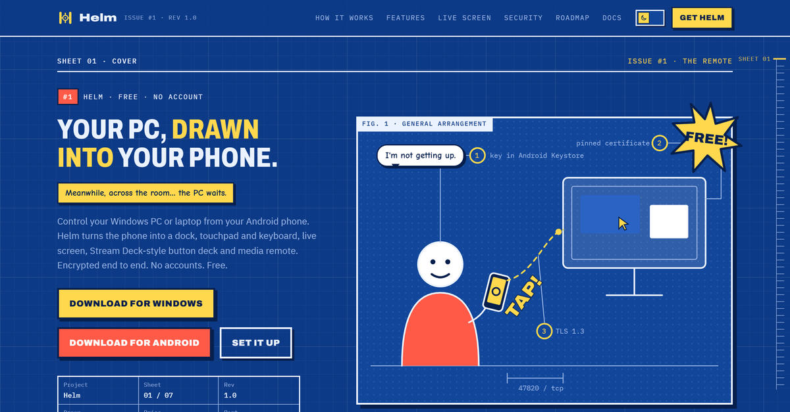
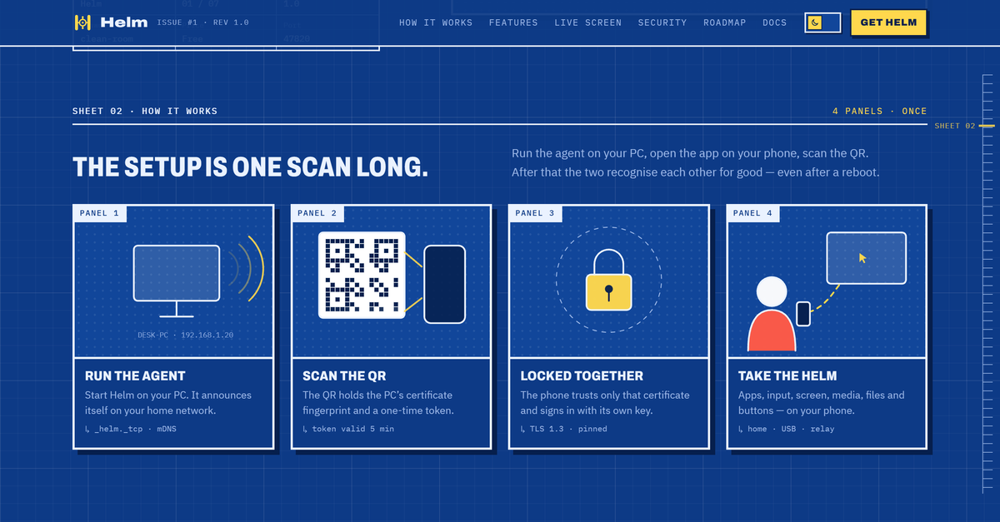
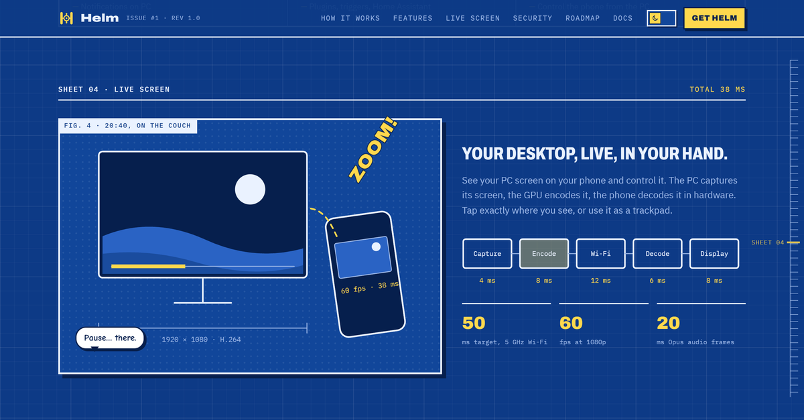
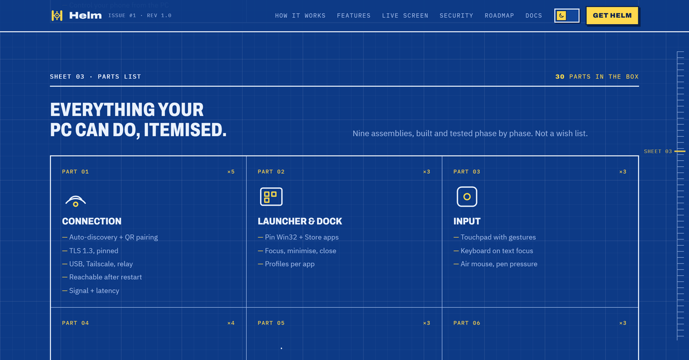
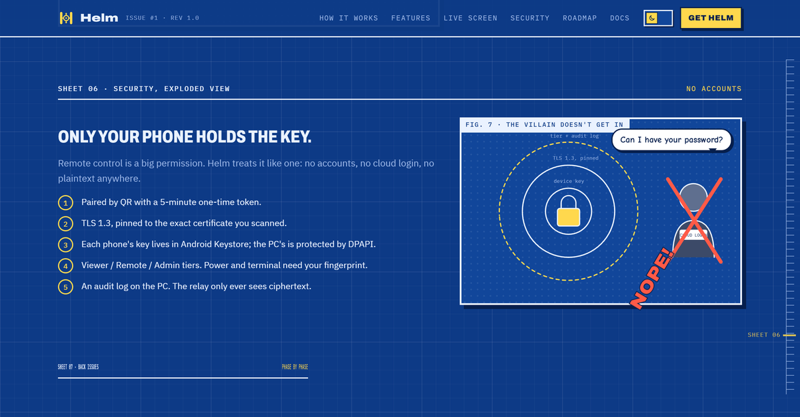

# Helm

**Your PC, drawn into your phone.** Control your whole Windows PC from your Android phone: apps, touchpad and keyboard, a live screen, media, files and one-tap buttons, over an encrypted connection with no account.

[Website](https://helm.niranjand.in) · [Download](https://github.com/Niranjan266/helm/releases/latest) · [Protocol docs](Docs/PROTOCOL.md) · [How I built it](https://www.niranjand.in/blog/helm-secure-android-remote-for-windows-pc)



## What it is

Helm turns your Android phone into a remote for your Windows PC. Install the small Helm app on the PC, scan a QR code with your phone once, and from then on the phone can launch apps, act as a touchpad and keyboard, show the PC screen live, control music and volume, move files and run a grid of shortcut buttons, like a Stream Deck in your pocket.

There is no account, no cloud login and no subscription. The phone and the PC talk to each other directly over your home network, and every connection is encrypted. It is free for Windows 10/11 and Android 8.0+.

## Features

- **One-scan setup.** The PC announces itself on your Wi-Fi; scan its QR code (or type a 6-digit code) and the two stay paired, even after a reboot.
- **Launcher dock.** Pin desktop and Store apps, with folders and pages; focus, minimise or close windows.
- **Touchpad and keyboard.** Full-screen touchpad with gestures, a floating keyboard that opens when a text box is focused, gyro air mouse and pen pressure.
- **Live screen.** See your desktop on the phone in real time with sound; tap exactly where you see, or use it as a trackpad. Pick a monitor or a single window.
- **Button grid (Deck).** Colourful buttons for hotkeys, text, apps, media and multi-step macros, with live widgets and per-app profiles.
- **Media and system.** Now playing with artwork, volume and per-app mixer, brightness, lock / sleep / shut down with a timer.
- **Files and clipboard.** Send files both ways from the share sheet, browse PC folders, shared clipboard with history.
- **Monitor and manage.** CPU, RAM, disk, network and battery charts, alerts, a task manager and a PowerShell terminal (admin only).
- **Everyday extras.** Find my phone, PC notifications on the phone, schedules, presentation remote with a laser pointer, home-screen widgets, Quick Settings tiles and a Wear OS companion.
- **Bluetooth mode.** No Wi-Fi and no Helm on the PC? The phone can act as a standard Bluetooth mouse and keyboard.
- **Anywhere access (optional).** An optional relay lets the phone reach the PC away from home; the relay only ever sees encrypted bytes.
- **Updates itself.** Both apps check GitHub Releases and install only signed, verified updates.

## Screenshots

| | |
|---|---|
|  |  |
| *Setup is one scan long* | *The live screen pipeline* |
|  |  |
| *Everything the PC can do, itemised* | *Only your phone holds the key* |

## How it works

Helm has three parts: a **Rust agent** on the PC, a **native Kotlin app** on the phone and an **optional Cloudflare relay** for use away from home.

```
 Android app (Kotlin + Jetpack Compose)
   │  1. mDNS  _helm._tcp            → finds the PC on the LAN
   │  2. QR: address + cert fingerprint + one-time token
   │  3. wss://pc:47820/ws           → JSON control channel (TLS, certificate pinned)
   │  4. wss://pc:47820/stream       → binary H.264 video + Opus audio (second pinned socket)
   ▼
 Helm.exe  (Tauri 2 window + tray, runs the agent in-process)
   └─ helm-agent (Rust, tokio + rustls)
        ├─ router: permission tiers (viewer < remote < admin) + audit.log
        └─ helm-win-* crates: apps · input · capture · audio · system · sysmon
                              record · terminal · pen · notify · plugins · update

 Away from home (optional, off by default):
 phone ──wss /connect/<host_id>──▶ Relay Worker + Durable Object ◀──wss /host/<host_id>── PC
                                   (blind byte pipe: the pinned TLS session runs inside it)
```

### Pairing and trust

- On first run the PC creates a self-signed **ECDSA P-256** certificate and a permanent `host_id`; the private key is protected with **DPAPI**.
- The QR code carries the PC's addresses, the **SHA-256 fingerprint** of that certificate and a **one-time 256-bit token** valid for 5 minutes.
- The phone skips normal CA validation and **pins** the exact certificate from the QR, so a fake PC fails before the token is ever sent.
- Each phone generates its own non-exportable key in **Android Keystore**. After pairing it signs a challenge on every connect, so there is no PIN to type again.
- Bad tokens lock pairing out; the 6-digit code path is one attempt per code, locks after 3 failures and is LAN-only, because 20 bits is fine against a few online guesses on your Wi-Fi but not on the internet. The design and threat model are in [Docs/protocol/pairing-security.md](Docs/protocol/pairing-security.md).
- Every method declares a minimum tier (`viewer`, `remote`, `admin`). Power, kill, file delete and the terminal need `admin`, can require a fingerprint check on the phone and are written to `audit.log`.

### Low-latency input and screen

- **Input never waits.** Touchpad motion, scroll and keys are sent as fire-and-forget `in` frames with no request id and no reply. The agent maps moves to absolute positions so Windows pointer speed and "Enhance pointer precision" do not distort them; the phone uses density-independent deltas, every historical touch sample, a tremor filter and sub-pixel carry.
- **Screen.** Windows.Graphics.Capture grabs the monitor or window, the Media Foundation **hardware H.264 encoder** (low-latency, CBR, no B-frames, on-demand IDR) encodes it, and WASAPI loopback audio is encoded to Opus in 20 ms frames. The phone decodes with `MediaCodec` straight to a `SurfaceView` and renders immediately. The cursor is sent separately and drawn on the phone so it never smears. The target set for this phase was under 50 ms glass-to-glass at 1080p60 on 5 GHz Wi-Fi.
- **Recording** passes the H.264 access units straight into an MP4 (no re-encode) with AAC audio.

### Anywhere access

The relay ([relay/README.md](relay/README.md)) is a Cloudflare Worker with one Durable Object per PC. The PC keeps one outgoing WebSocket; phones connect to `/connect/<host_id>` and the normal pinned TLS session runs inside the tunnel, so the relay sees only ciphertext and stores nothing about phones. It is off by default, and QR-token pairing is the only pairing allowed through it. When the PC is reachable on the LAN again, the phone swaps back to the direct path.

### Reliability and updates

- The phone reconnects by itself after Wi-Fi changes or a PC restart (backoff from 0.5 s to 30 s, retrying at once when the network returns or mDNS sees the PC), and it only ever re-authenticates, never re-pairs.
- An optional `HelmSignIn` Windows service keeps a restricted Helm reachable before you sign in (ping, info, lock, sleep, restart, shut down only).
- Releases ship with SHA-256 sums and **Ed25519 signatures**. The desktop and Android updaters check size, hash and signature against the public key in [`keys/update-ed25519.pub`](keys/update-ed25519.pub) and refuse anything else.

### Engineering principles

- **Protocol first.** Every message is specified in [Docs/PROTOCOL.md](Docs/PROTOCOL.md) and the `Docs/protocol/` notes before code changes, and old phones and new PCs negotiate features (`hello.features`) so they degrade gracefully.
- **Clean-room.** Other remote apps were idea references only; the Windows side is written from Microsoft documentation. See [CONTRIBUTING.md](CONTRIBUTING.md).
- **No AI features**, no telemetry and no accounts.
- **Tested in layers.** Each Rust crate has unit tests and clippy runs with `-D warnings` in CI; the Android core is plain Kotlin tested on the JVM against a fake agent, including real pinned TLS and a fake relay that asserts it never sees plaintext; an opt-in end-to-end test pairs a phone client with the real Rust agent.

## Tech stack

| Area | Technology |
|---|---|
| PC agent | Rust (edition 2024), tokio, rustls, tokio-tungstenite, `windows` crate (Win32 / WinRT / COM), mdns-sd, p256, rcgen |
| PC media | Windows.Graphics.Capture, Media Foundation H.264, WASAPI loopback, Opus |
| PC app | Tauri 2 (HTML/CSS/JS UI), tray-icon, NSIS installer |
| Automation | wasmtime WASM plugins, triggers, Home Assistant client |
| Android | Kotlin, Jetpack Compose (Material 3), OkHttp, MediaCodec, Android Keystore, NSD, Wear OS (Compose for Wear) |
| Relay | Cloudflare Workers + Durable Objects (TypeScript), Vitest |
| CI / release | GitHub Actions (tests only); local signed release script |

## Getting started

### Install (users)

**Windows**: paste into PowerShell:

```powershell
irm https://raw.githubusercontent.com/Niranjan266/helm/main/scripts/install.ps1 | iex
```

It downloads the newest release (`Helm-windows-x64.exe`), checks its SHA-256, installs it as `%LOCALAPPDATA%\Programs\Helm\Helm.exe`, adds a Start menu entry and opens Helm. Run it again to update. Releases also include `Helm-windows-x64-setup.exe`, a regular installer.

Helm is a desktop app with a window (status, phones, pairing QR, activity, settings) and a tray icon. **Closing the window keeps Helm running in the tray**, so phones stay connected; use the tray's **Quit Helm** to stop it. *Start with Windows* (Settings) starts it hidden in the tray. Windows 11 already has the WebView2 runtime it needs.

**Android**: download `Helm-android.apk` from [Releases](https://github.com/Niranjan266/helm/releases) and install it. Open it, tap **Pair with QR** and scan the code in the Helm window. Windows will ask to allow Helm on **Private** networks; allow it.

### Build from source

Prerequisites: Rust (stable, MSVC), the Tauri CLI, Android SDK (platform 34) with JDK 17 or 21, and Node.js for the relay.

```powershell
# PC app
cargo install tauri-cli --version "^2" --locked   # once
cd host/desktop
cargo tauri build      # target\release\Helm.exe + NSIS installer; or `cargo tauri dev`

# Console agent (prints the pairing QR in the terminal)
cd host/agent
cargo run --release

# Android app (AGP needs JDK 17/21, e.g. Android Studio's JBR)
$env:JAVA_HOME = "C:\Program Files\Android\Android Studio\jbr"
cd android
.\gradlew.bat testDebugUnitTest assembleDebug     # app/build/outputs/apk/debug/app-debug.apk

# Relay
cd relay
npm install
npm test
```

### Tests

```powershell
cd host/agent; cargo test                       # agent
cd android; .\gradlew.bat testDebugUnitTest     # Android JVM tests
.\scripts\test-all.ps1                          # every crate, agent, relay, Android and real E2E
```

The opt-in end-to-end test against a running agent is described in [android/README.md](android/README.md#opt-in-end-to-end-test-against-the-real-pc-agent).

Android release signing reads `HELM_ANDROID_KEYSTORE`, `HELM_ANDROID_KEYSTORE_PASSWORD` and optionally `HELM_ANDROID_KEY_ALIAS` / `HELM_ANDROID_KEY_PASSWORD`; without them it builds an unsigned APK, and debug builds always use the debug key.

## Project structure

```
helm/
├─ host/
│  ├─ agent/          Rust agent library + helm-agent console program
│  ├─ desktop/        Helm.exe: Tauri 2 window + tray running the agent in-process
│  ├─ crates/         helm-win-* (apps, input, capture, audio, system, sysmon, record,
│  │                  terminal, pen, notify), helm-plugins, helm-service, helm-update
│  └─ installer/      installer script
├─ android/
│  ├─ app/            phone app: core/ (plain Kotlin, JVM-tested), device/, ui/ (Compose)
│  ├─ wear/           Wear OS companion
│  └─ wearlink/       shared phone ↔ watch message codec
├─ relay/             Cloudflare Worker + Durable Objects tunnel
├─ keys/              Ed25519 public key for update verification
├─ scripts/           install.ps1, release.ps1, test-all.ps1, e2e-relay.ps1
└─ Docs/              PLAN, ROADMAP, PROTOCOL and protocol/ feature specs
```

Each component has its own README with more detail: [host/agent](host/agent/README.md), [host/desktop](host/desktop/README.md), [android](android/README.md), [relay](relay/README.md) and every crate under `host/crates/`.

## Documentation

| Document | What |
|---|---|
| [Docs/PLAN.md](Docs/PLAN.md) | Research, full feature list, architecture and decisions |
| [Docs/ROADMAP.md](Docs/ROADMAP.md) | Phase-by-phase build plan with test gates |
| [Docs/PROTOCOL.md](Docs/PROTOCOL.md) | Phone ↔ PC wire protocol |
| [Docs/protocol/pairing-security.md](Docs/protocol/pairing-security.md) | Code pairing, approve-on-PC, threat model |
| [Docs/protocol/streaming-2.md](Docs/protocol/streaming-2.md) | Window picker, gaming presets, second screen |
| [Docs/protocol/phone-control.md](Docs/protocol/phone-control.md) | The other way round: see and control the phone from the PC, with its owner's consent |

## Status

Current release: **v0.5.0**. Phases 0 to 5b of the [roadmap](Docs/ROADMAP.md) are done (pairing, daily-driver controls, live screen, power-user tools, anywhere access and the advanced extras); Phase 6 (full-screen control, in-app updates, anywhere by default) is in progress. A virtual camera, second-monitor mode, gamepad and an iOS client are not built yet.

## Contributing

Read [CONTRIBUTING.md](CONTRIBUTING.md) first, especially the clean-room rule. Before a pull request, `cargo test` in `host/agent` and `.\gradlew.bat testDebugUnitTest assembleDebug` in `android/` must pass, and protocol changes go into `Docs/PROTOCOL.md` first.

## License

Released under the MIT License — see [LICENSE](LICENSE).

## Author

Built by Niranjan D — [niranjand.in](https://www.niranjand.in) · [GitHub](https://github.com/Niranjan266) · [LinkedIn](https://www.linkedin.com/in/niranjan266)
